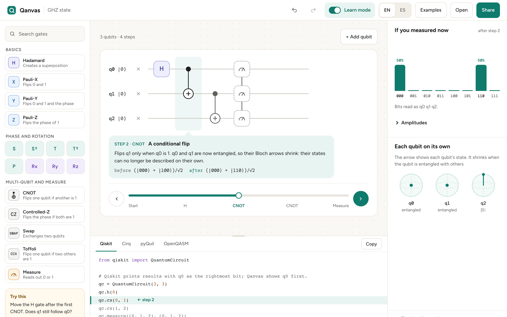

# Qanvas

[](https://github.com/Ethan-Rivas/qanvas/actions/workflows/ci.yml)
[](LICENSE)


**A friendly visual quantum circuit builder that runs in your browser.** Drag gates onto qubits, watch the results update live, step through the circuit with plain-language explanations, and copy working Qiskit, Cirq, pyQuil or OpenQASM code.

[Leer en español](README.es.md)



The visual tools students meet first tend to look and feel dated, and the polished ones need an account and a connection. Qanvas is built for students first and researchers second: no account, no install, works offline, in English and Spanish. It's the circuit builder of [quantum-lab](https://github.com/Ethan-Rivas/quantum-lab), and it also runs on its own.

## Try it

Open **https://ethan-rivas.github.io/qanvas/** in a recent browser. After the first visit it works without internet, and your browser can install it as an app (in Chrome: the install icon in the address bar; on an iPhone: Share → Add to Home Screen).

Nothing is uploaded: the circuit is simulated on your own computer, and a share link carries the whole circuit inside it.

## What you can do

- **Build circuits** with up to 12 qubits (24 in quantum-lab): H, X, Y, Z, S, S†, T, T†, Rx, Ry, Rz and P with any angle, CNOT, CZ, SWAP, Toffoli, measurement and Reset (back to |0⟩). Measure in any step and keep using the qubit; a one-qubit gate can run only if an earlier measurement gave 0 or 1, drawn with a double line. Drag from the palette, move, copy, delete, undo and redo.
- **See the results live:** the probability of each outcome, the amplitudes, and one Bloch sphere per qubit, whose arrow shrinks when the qubit is entangled.
- **Add noise:** the Noise button sets gate errors and readout errors. The results show the noisy bars beside dashed outlines of the result without noise, and the Bloch arrows shrink as the qubit loses its state. Share links and files keep the noise. Qiskit and Cirq export include it; pyQuil and OpenQASM leave it out and say so.
- **Step through the circuit** with the slider. In Learn mode, a short explanation at each step says what the gate did, with the state before and after.
- **Copy or download code** in Qiskit, Cirq, pyQuil or OpenQASM 2.0, with the line for the current step highlighted. Downloads include a ready-to-run notebook or Python script that runs the circuit and counts the outcomes.
- **Edit the OpenQASM code** directly: the circuit updates when you pause typing, and keeps its last valid version while the code has a mistake.
- **Start from an example:** Bell state, GHZ state, superdense coding, quantum teleportation, bit-flip code, Bell state with noise, Deutsch–Jozsa and Grover search (2 qubits), each with a "Try this" challenge.
- **Share** a link or save a file, and **open** a file, OpenQASM 2.0 code or a link from Quirk or Quirk-E.

Everything works with the keyboard too: focus a gate, press **Space** to pick it up, move with the **arrow keys** and press **Space** to drop it. **Ctrl/⌘ + Z** undoes, **Ctrl/⌘ + C** and **V** copy and paste, and **Delete** removes the selected gate.

Qanvas writes kets with q0 first (leftmost), like Cirq and Quirk. Qiskit writes q0 last, so `|110⟩` in Qanvas is `011` in Qiskit's results. The exported Qiskit code reminds you of this.

## Run it in quantum-lab

In [quantum-lab](https://github.com/Ethan-Rivas/quantum-lab), `docker compose up` starts Qanvas next to JupyterLab at **http://127.0.0.1:8080**. There, Qanvas can do more:

- **Open in notebook** saves the circuit as a notebook in the lab's `notebooks/qanvas/` folder and opens it in JupyterLab.
- **Run with Qiskit Aer** runs circuits of 13 to 24 qubits, which are too large for the browser, and shows the counts.
- **Edit Qiskit, Cirq and pyQuil code**: the lab runs your code, loops included, and the diagram shows the circuit it builds. Your code stays as you wrote it until you change the diagram. [docs/quantum-lab.md](docs/quantum-lab.md) describes how it's set up there.

Circuits with gate noise, a measurement partway through or a reset run in the browser up to 8 qubits (noise on readings alone runs up to 12). Above that they will run on Aer once quantum-lab supports it ([the spec](docs/superpowers/specs/2026-10-13-lab-run-noise.md)).

To run only Qanvas with Docker:

```bash
docker run --rm -p 127.0.0.1:8080:8080 ghcr.io/ethan-rivas/qanvas:latest
```

## Run it from the source

You need [Node.js](https://nodejs.org/) 22 or later.

```bash
git clone https://github.com/Ethan-Rivas/qanvas.git
cd qanvas
npm install
npm run dev
```

Then open **http://localhost:5173**. Offline mode only works in a built copy: `npm run build && npx vite preview`.

## How it stays correct

Every result Qanvas shows is checked against Qiskit, so you can trust it.

- **Simulator:** `reference/generate.py` builds test circuits in Qiskit (every gate on each qubit position, every example, and 200 random circuits from 1 to 12 qubits) and saves their exact final states. Qanvas must match every amplitude within 1e-9. Circuits with noise or a measurement partway through are compared with Qiskit's `DensityMatrix`, using Aer's noise channels. The script runs in the quantum-lab image (`npm run reference`); the reference files are never edited by hand.
- **Exported code:** `npm run test:export` runs the Qiskit, Cirq, pyQuil and OpenQASM code Qanvas generates for every test circuit, and imports the OpenQASM that Qiskit writes. For circuits that stay a state vector, every final state must match Qanvas's within 1e-9. Circuits with noise or a measurement partway through are checked by importing their OpenQASM as a density matrix and by sampling counts. This is what catches bit-order mistakes. It also runs the downloadable notebooks and scripts, whose counts must agree with Qanvas's probabilities. Exported code with noise is run many times and its counts are checked against Qanvas's exact probabilities.
- **Interface:** browser tests cover dragging with the mouse and the keyboard, stepping through, sharing, importing, offline use, phone screens and automated accessibility checks.

## Development

```bash
npm test             # unit tests and the Qiskit reference tests
npm run test:e2e     # browser tests (Playwright)
npm run test:export  # runs the exported code in the quantum-lab image (needs Docker)
npm run typecheck
npm run icons        # renders public/icons from the design tokens
```

`PLAN.md` is the project brief, `CLAUDE.md` the project rules and `RELEASE.md` the release checklist. Each release tag publishes the website to GitHub Pages and the web-server image to `ghcr.io/ethan-rivas/qanvas`.

## Roadmap

- [x] **0.2:** edit the OpenQASM code directly; import Quirk links; download the circuit as a notebook, a Python script or OpenQASM; "Open in notebook" to send it to JupyterLab; run bigger circuits with Qiskit Aer and edit Qiskit, Cirq and pyQuil code in quantum-lab.
- [x] **0.3:** noise models (depolarizing, readout error) with an ideal vs noisy view; measure anywhere in the circuit, reset, and gates that run only if a qubit measured 0 or 1.
- [ ] **0.4:** gates with any number of controls (including controls on 0), √X and √Y, QFT blocks, custom gates from a circuit or a matrix; lessons that chain several examples.
- [ ] **0.5:** import real Qiskit notebooks and pick one of their circuits, including long ones with hundreds of steps.
- [ ] **Later:** run on real IBM hardware through quantum-lab; collaboration.

## Contributing

Ideas, bug reports and pull requests are welcome, especially new examples and corrections to the explanations in either language. Before opening a pull request, check that `npm test` and `npm run test:e2e` pass.

## License

[MIT](LICENSE)
